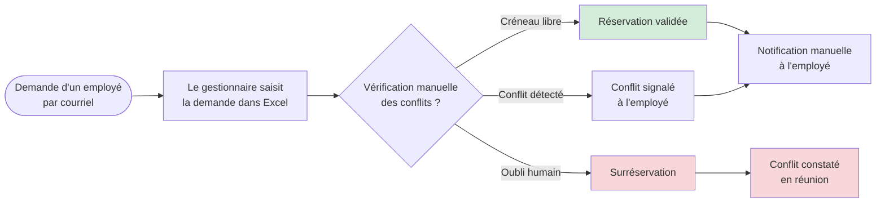

# Processus existant — réservation manuelle sous Excel

**Activité BC02 :** 2.1 (étude des procédures existantes), 2.3 (reconfiguration de processus)
**Source :** observation du fonctionnement de l'équipe Carpe Diem, juillet 2026
**Nature :** diagramme de flux (et non BPMN 2.0)

## Lecture du diagramme

- Le processus est **asynchrone** : la demande passe par un courriel, puis par une saisie manuelle.
- La détection des conflits repose entièrement sur la vigilance du gestionnaire.
- Aucun contrôle automatique ne garantit l'absence de double réservation.
- Les conséquences sont visibles en aval : surréservation, conflit découvert en réunion, correction manuelle.

## Limites à expliciter dans le mémoire

| Limite | Conséquence |
|---|---|
| Pas de source de vérité unique | Excel peut être dupliqué ou verrouillé |
| Pas de contrôle automatique | Le double-booking dépend de l'attention humaine |
| Pas de traçabilité | Aucun historique fiable des demandes et des décisions |
| Notification manuelle | Délai et oubli possibles |

Ce diagramme justifie le processus cible présenté dans `02-processus-cible-roomops.md`.
