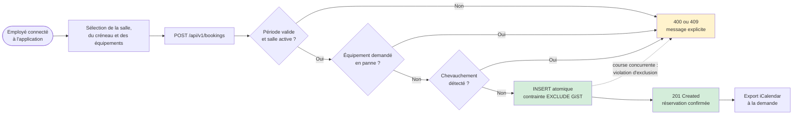
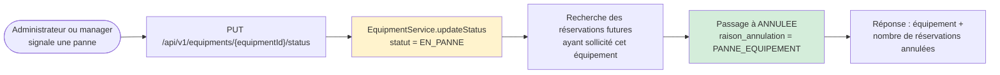

# Processus cible — réservation automatisée avec RoomOps

**Activité BC02 :** 2.3 (reconfiguration de processus), 2.6 (architecture applicative)
**Source :** `BookingService.createBooking`, contrainte `no_overlapping_booking` (Flyway `V1`)
**Nature :** diagramme de flux (et non BPMN 2.0)

## Lecture du diagramme

- La vérification applicative (`existsOverlapping`) donne un message métier explicite.
- La contrainte PostgreSQL `EXCLUDE USING GIST` reste le **garant ultime** : même si deux requêtes
  concurrentes passent la vérification applicative, une seule insertion aboutit.
- Un équipement en panne ne bloque que s'il est **réellement demandé** par la réservation
  (principe du choix éco-responsable).
- L'export iCalendar est une action distincte, déclenchée après la confirmation.

## Complément — déclaration de panne et annulation en cascade

Ce second flux est volontairement séparé : il ne fait pas partie de la création d'une réservation.

Cette séparation évite l'erreur fréquente qui consiste à représenter une annulation en cascade
au moment de la création d'une réservation. La cascade n'a lieu que lors du passage d'un
équipement à `EN_PANNE`.
