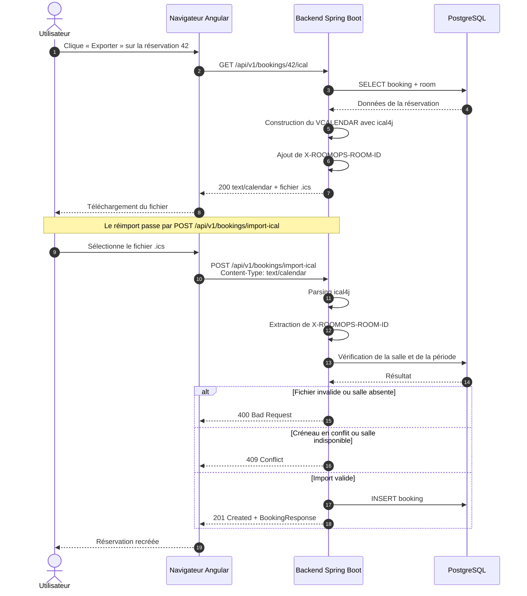

# Séquence — export et import iCalendar

**Activités BC02 :** 2.6 (architecture applicative), 2.12 (intégrabilité)
**Source :** `BookingController`, `IcalService`, `api-contract/openapi.yaml`
**Endpoints réels :** `GET /api/v1/bookings/{id}/ical` et `POST /api/v1/bookings/import-ical`

## Commentaire

- L'export produit un fichier **RFC 5545** lisible par Outlook, Google Agenda ou Apple Calendrier.
- La propriété `X-ROOMOPS-ROOM-ID` est indispensable : un fichier iCalendar générique ne référence
  aucune salle interne, donc il est refusé en `400`.
- L'import ne transporte pas les équipements sélectionnés : ils ne sont pas encodés dans l'export.
- L'import rejoue les contrôles métier de la création (période, salle active, équipement en panne,
  chevauchement), y compris la contrainte PostgreSQL.
- Le corps attendu est un binaire `text/calendar`, **pas** un formulaire `multipart`.
