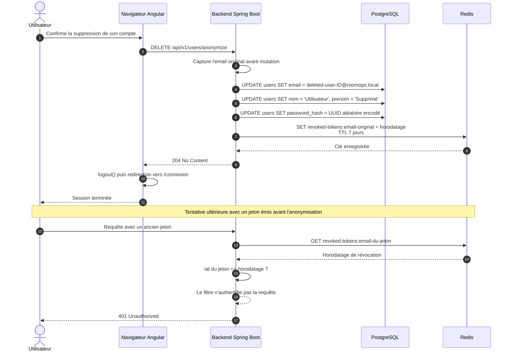

# Séquence — anonymisation RGPD et révocation des jetons

**Activités BC02 :** 2.2 (conformité à la gouvernance), 2.12 (mise en exploitation)
**Source :** `UserController.anonymizeUser`, `UserService.anonymizeCurrentUser`,
`TokenRevocationService`, `JwtAuthenticationFilter`, `profile.ts`

## Commentaire

- Le verbe est **`DELETE`**, pas `POST` ; la réponse est **`204 No Content`**, pas `200 OK`.
- Les données personnelles remplacées sont l'email, le nom et le prénom ; le mot de passe devient
  un UUID aléatoire encodé, jamais communiqué.
- Les réservations sont conservées pour l'historique d'occupation des salles, mais elles ne sont
  plus rattachées à une identité exploitable.
- La révocation est volontairement **grossière** : une entrée par email, valant « tout jeton émis
  avant cet instant est invalide ». Le TTL de 7 jours correspond à la durée de vie maximale d'un
  refresh token.
- La déconnexion est orchestrée par le frontend après le `204` : le backend révoque, le navigateur
  ferme la session et redirige.
- Le filtre JWT ne renvoie pas lui-même le `401` : il laisse la requête non authentifiée, puis
  la chaîne de sécurité la rejette.
