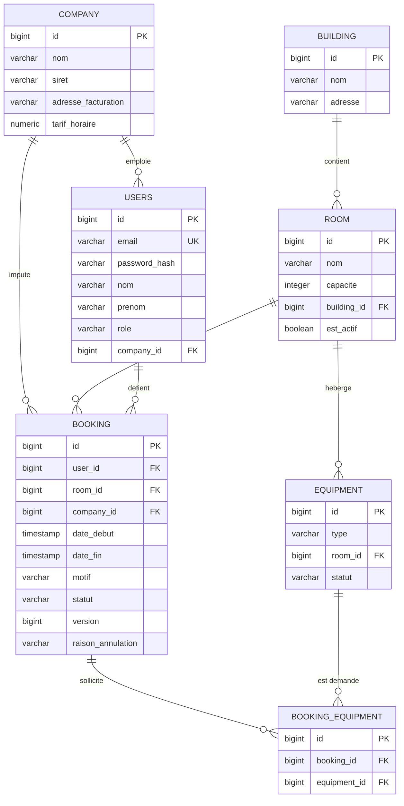

# Modèle relationnel — base RoomOps

**Activité BC02 :** 2.5 (conception d'une base de données)
**Source :** migrations Flyway `V1` à `V7`, entités du package `domain`
**Homologation :** les noms de colonnes sont ceux du schéma SQL, pas des noms anglais génériques.

## Règles de gestion portées par le schéma

| Règle | Mise en œuvre | Migration |
|---|---|---|
| Une salle ne peut pas être réservée deux fois sur le même créneau | `EXCLUDE USING GIST (room_id WITH =, tsrange(date_debut, date_fin) WITH &&) WHERE (statut != 'ANNULEE')` | `V1` |
| Un super-administrateur n'appartient à aucune entreprise | `chk_user_company_by_role` | `V1` |
| Un manager ou un employé appartient obligatoirement à une entreprise | `chk_user_company_by_role` | `V1` |
| Le statut d'un équipement est borné | `CHECK (statut IN ('OPERATIONNEL', 'EN_PANNE'))` | `V1` |
| Le statut d'une réservation est borné | `CHECK (statut IN ('CONFIRMEE', 'ANNULEE'))` | `V1` |
| La date de fin suit la date de début | `CHECK (date_fin > date_debut)` | `V1` |
| Un équipement n'est lié qu'une fois à une réservation | `UNIQUE (booking_id, equipment_id)` | `V5` |
| La raison d'annulation est bornée | `CHECK (raison_annulation IS NULL OR raison_annulation IN ('MANUELLE', 'PANNE_EQUIPEMENT'))` | `V6` |

## Précisions sur les attributs

- **`periode` n'est pas une colonne.** C'est une valeur calculée `tsrange(date_debut, date_fin)`
  utilisée par la contrainte d'exclusion `no_overlapping_booking`. Elle ne doit donc pas figurer
  comme attribut de la table `booking`.
- **`raison_annulation`** vaut `NULL` pour une réservation non annulée, `MANUELLE` pour une
  annulation volontaire, `PANNE_EQUIPEMENT` pour une annulation en cascade.
- **`version`** porte le verrouillage optimiste JPA (`@Version`).
- **`users.company_id`** est nullable en SQL, mais la contrainte `chk_user_company_by_role`
  impose sa présence pour `MANAGER` et `EMPLOYEE`, et son absence pour `SUPER_ADMIN`.
- **Index** : `idx_room_building_id`, `idx_equipment_room_id`, `idx_users_company_id`,
  `idx_booking_room_id`, `idx_booking_user_id`, `idx_booking_company_id`,
  `idx_booking_equipment_booking_id`, `idx_booking_equipment_equipment_id`.
- **Volumétrie et rétention** : à compléter dans le mémoire (nombre de salles, de réservations,
  durée de conservation des historiques, politique de purge).

## Note sur la reprise de l'existant

Le modèle ne reprend pas la structure du fichier Excel : il la normalise. La table `company`
reprend les entreprises, `building` et `room` remplacent les feuilles ou colonnes de salles,
et `booking` remplace les lignes de réservation. Cette normalisation est le point à expliciter
pour l'activité 2.5, qui demande de tenir compte de l'existant.
