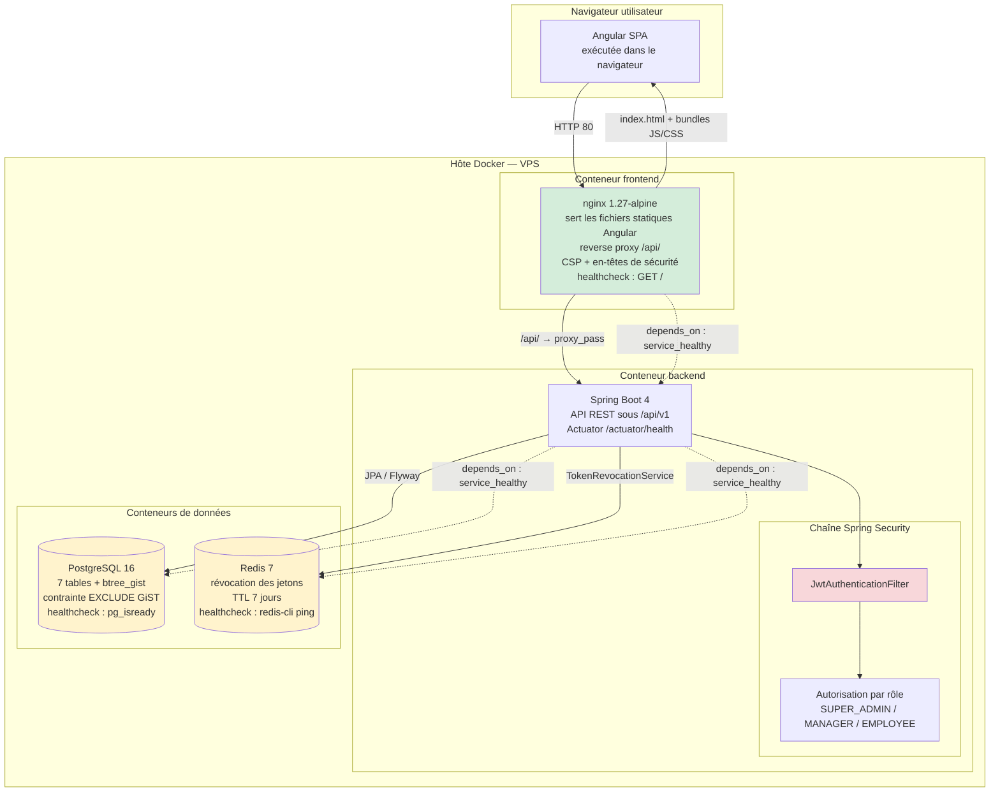

# Architecture de déploiement — Docker

**Activités BC02 :** 2.6 (urbanisation), 2.12 (mise en exploitation)
**Source :** `docker-compose.prod.yml`, `frontend/nginx.conf`, `application-prod.properties`

## Lecture du diagramme

- Le navigateur exécute l'application Angular ; nginx lui **sert** les fichiers statiques.
- nginx est aussi le **reverse proxy** : `/api/` est transmis tel quel au backend, dont le
  `server.servlet.context-path` vaut `/api/v1`.
- `JwtAuthenticationFilter` et l'autorisation par rôle sont des composants **internes** au backend,
  pas des conteneurs.
- Les flèches en pointillés représentent uniquement l'ordre de démarrage (`depends_on` avec
  `condition: service_healthy`), pas des appels HTTP.
- Les healthchecks sont exécutés **dans** chaque conteneur par Docker :
  - PostgreSQL : `pg_isready` ;
  - Redis : `redis-cli ping` ;
  - backend : `GET http://localhost:8080/api/v1/actuator/health` ;
  - nginx : `GET http://localhost/`.

## Points à expliciter dans le mémoire

| Choix | Justification | Limite assumée |
|---|---|---|
| nginx comme unique point d'entrée | TLS et en-têtes de sécurité centralisés | un seul reverse proxy, pas de haute disponibilité |
| Réseau Docker interne | PostgreSQL et Redis ne sont pas exposés publiquement | à vérifier dans le compose de production |
| Healthchecks | ordre de démarrage fiable, redémarrage des conteneurs défaillants | ne teste pas les parcours métier |
| Volumes persistants | données PostgreSQL conservées entre les déploiements | sauvegarde et restauration à documenter |
| Images versionnées | retour arrière possible via `IMAGE_TAG` | procédure de rollback à tester |

