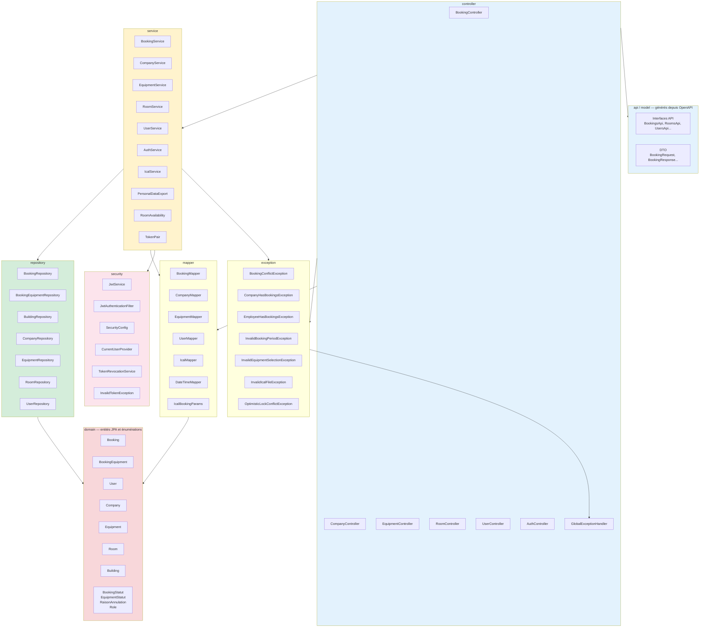

# Organisation des packages du backend

**Activités BC02 :** 2.6 (architecture en couches), 2.7 (degré de réutilisation)
**Source :** arborescence réelle de `backend/src/main/java` et interfaces générées depuis OpenAPI

## Corrections apportées au diagramme initial

| Élément | Emplacement initial | Emplacement réel |
|---|---|---|
| `TokenRevocationService` | `service` | `security` |
| `GlobalExceptionHandler` | `exception` | `controller` |
| `RoomMapper` | `mapper` | n'existe pas (supprimé) |
| `Controllers → Mappers` | absent | les contrôleurs utilisent les mappers |

## Précisions sur les couches

- **`api` et `model` sont générés** par le plugin OpenAPI à partir de `api-contract/openapi.yaml`.
  Les contrôleurs implémentent les interfaces (`BookingController implements BookingsApi`) ;
  les DTO ne sont pas écrits à la main.
- **Les contrôleurs utilisent directement les mappers** pour convertir les entités en DTO.
  Ce n'est pas une couche de service pure, mais c'est le choix réel du projet.
- **`GlobalExceptionHandler`** est un `@RestControllerAdvice` placé dans `controller` : il traduit
  les exceptions métier en réponses HTTP (`400`, `401`, `403`, `404`, `409`).
- **`InvalidTokenException`** est dans `security`, pas dans `exception` : elle est interne à la
  chaîne d'authentification.
- **`TokenPair`**, `PersonalDataExport` et `RoomAvailability` sont des objets de service
  (records ou classes utilitaires), pas des entités.
- **Les énumérations** `BookingStatut`, `EquipmentStatut`, `RaisonAnnulation` et `Role` vivent
  dans `domain`, aux côtés des entités.

## Ce que le diagramme ne montre pas

- Les dépendances vers Spring Data JPA, Spring Security, ical4j et Redis.
- Le sens des dépendances vers les packages générés (`api`, `model`).
- Les tests, qui suivent la même arborescence dans `src/test/java`.

Ces éléments relèvent du texte de la section 2.6, pas nécessairement du diagramme.
